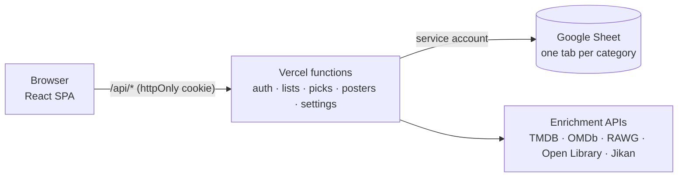

# My Lists

**A private archive for everything I watch, play and read.** My Lists is a personal media tracker for movies, series, anime, games and books. Each category has its own theme, and a Google Sheet holds all the data.

**Live:** [my-lists-zeus.vercel.app](https://my-lists-zeus.vercel.app). It's a single-user app, so it sits behind a login and asks search engines not to index it.


## Why I built it

I track nearly a thousand titles in one Google Sheet: what I'm watching, what's next, what I finished, and what I thought of it. The sheet is a good place to store everything but a poor place to browse it. My Lists keeps the sheet as the only source of truth and puts a fast, good-looking app on top. You get posters, ratings, filters, and a way to answer "what should I watch tonight?" in a couple of taps.

## Features

- **Rustic, classy design.** The look is a dark wood and paper "private archive". Each category has its own theme:
  - Movies: a gold film strip.
  - Series: a retro TV.
  - Anime: comic-book cards.
  - Games: neon arcade.
  - Books: parchment.
- **Home dashboard.** Shows Now watching, Now reading, Next season out, Paused / On hold, Recently finished and Top rated, plus totals and my average rating. There's also global search, which opens a result's detail without leaving the page.
- **Category pages.**
  - Status tiles and a status progress bar.
  - Quick status chips with counts.
  - Shelves, Grid and Table views.
  - Per-list search.
- **Smart filters.** Sort by, Group by, Genre, Year, Director/Creator, Franchise, Rating and preset smart views such as Top rated and Recently finished.
- **Item modal.** Poster, "Why it's on my list", year, genre, director, franchise, IMDb rating, status buttons and half-star ratings. Changes are written straight back to the Google Sheet, and finishing a title records the date.
- **Pick for tonight.** Choose a category, statuses and genres, then draw a random title from what's left. You can draw again or jump to the title in its list.
- **Picks deck.** Swipeable recommendations for movies, series and games ("Because you liked …"), sorted into Want to / Must watch / Maybe / Watched, or skipped for now.
- **Automatic enrichment.**
  - Posters, IMDb ratings, creators and franchises come from TMDB, OMDb, RAWG, Open Library and Jikan.
  - Fill-only writes never overwrite my own data.
  - A Data health panel in Settings shows what's still missing.
- **Mobile-first layout.** A bottom tab bar, a full-screen item modal and touch-friendly shelves.

## Screenshots

| Item modal | Filters |
| --- | --- |
|  |  |
| **Pick for tonight** | **Picks deck** |
|  |  |

**A theme per category**

| Movies | Series |
| --- | --- |
|  |  |
| **Anime** | **Games** |
|  |  |
| **Books** | **Settings and data health** |
|  |  |

**Mobile**

| Home | Games | Item | Lists |
| --- | --- | --- | --- |
|  |  |  |  |

## Tech stack

- **Frontend:**
  - React 19, TypeScript, Vite and React Router.
  - TanStack Query for data.
  - Tailwind CSS 4 with Radix and shadcn-style components, Motion for animation, and Embla for carousels.
  - Fuse.js for fuzzy search.
- **API:** Vercel serverless functions written in TypeScript, with zod validation.
- **Data:** the Google Sheets API, using a service account.
- **Auth:** a bcrypt password check, and a JWT signed with `jose` in an httpOnly cookie.
- **Enrichment:** TMDB, OMDb, RAWG, Open Library and Jikan (MyAnimeList).
- **Tooling:** Vitest with Testing Library, Oxlint, and `tsc` for typechecking.
- **Hosting:** Vercel, which deploys automatically on every push to `main`.

## Architecture



- **The Google Sheet is the database.** Each category is a tab. The server maps sheet headers to fields, so moving or renaming columns doesn't break the app.
- **Reads** go through a short-lived in-memory cache on the server, with a forced refresh available from the app.
- **Writes** are narrow and checked:
  - The item modal can change only status, rating and the "why" note, and only to values allowed for that category.
  - Enrichment can only fill empty poster, creator, franchise and rating cells, guarded by a per-tab write policy.
- **The frontend** never talks to Google directly. All API keys stay on the server.

## Security

- The password is checked against a **bcrypt hash** stored in an environment variable. The password itself is never stored.
- The session is a **JWT in an `HttpOnly`, `SameSite=Lax` cookie**, marked `Secure` in production. It's never returned in JSON or kept in `localStorage`.
- The **login is rate-limited**: after 5 failed attempts in 15 minutes, further attempts get a `429`.
- **Security headers** are set in `vercel.json`:
  - A strict Content-Security-Policy (`script-src 'self'`, images and connections allowlisted per provider, `frame-ancestors 'none'`).
  - HSTS, `X-Frame-Options: DENY`, `nosniff`, a locked-down `Permissions-Policy`, and `noindex`.
- **Secrets stay on the server.** The only `VITE_` variable is a public feature flag. The sheet is shared only with the service account. See [SECURITY.md](SECURITY.md).

## Local setup

```bash
npm install
cp .env.example .env
npm run hash -- "your-password"   # paste the hash into AUTH_PASSWORD_HASH
npm run dev
```

- Fill in `.env` from [`.env.example`](.env.example), which lists every variable with a comment. Never commit `.env`.
- `npm run dev` starts the Vite app at `http://localhost:5173` and the local API, and proxies `/api` to `API_DEV_PORT` (default 3001).
- `npm run typecheck`, `npm run lint` and `npm run test` check the project.
- Setup for Google, TMDB, OMDb and RAWG is in [docs/SETUP.md](docs/SETUP.md). Deployment is in [DEPLOY.md](DEPLOY.md).

## Credits

This product uses the TMDB API but is not endorsed or certified by TMDB. IMDb ratings come from OMDb, game data from RAWG, and book covers from Open Library. See [CREDITS.md](CREDITS.md).

## License

[MIT](LICENSE) © 2026 Anish Sinha

